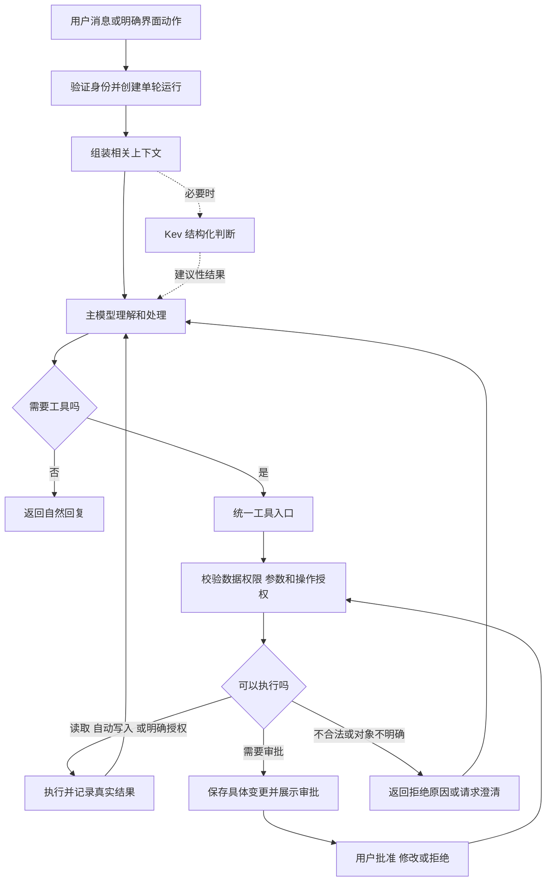

# 对话系统重构设计

日期：2026-10-19。状态：已按用户确认采纳新旧设计对照建议，并完成本轮代码重构。实施参数、已执行验证及部署状态以[实施与验收记录](../测试验收/提示词与业务测试/对话系统完整实施与验收记录-2026-10-19.md)为准；设计要求不等于全部场景已经通过。

修订：已将新旧设计对照取舍合入正文，统一自然交流、专业能力、上下文、写入授权、事务与资产生效口径，补齐原有业务闭环。全面验收见[对话系统全面验收矩阵](../测试验收/提示词与业务测试/对话系统全面验收矩阵-2026-10-19.md)，含截图与专业角色专项共175个用例族；执行覆盖和环境条件单独记录。

## 1. 背景、范围与决策状态

用户反馈现有智能体难以正常交流。本轮先审查、修复并推送了一批上下文、授权和持久化问题，随后进一步讨论了完整的对话系统设计。本文件汇总讨论，补充可实施的状态、权限及验收约束。

相关记录：

- [对话机制与问题审计](../测试验收/提示词与业务测试/智能体对话机制与问题审计-2026-10-19.md)。
- [修复与验证记录](../测试验收/提示词与业务测试/对话智能体修复与验证记录-2026-10-19.md)。
- [完整设计文档](完整设计文档.md)：既有业务模型的背景；与本基线冲突的对话控制规则按本设计第16节替代，不再同时执行两套口径。
- [前端用户需求基线](../前端/需求与规范/用户需求基线.md)：保留当前正式界面体系，不重新设计全站。

明确的产品方向：普通咨询自然回答；业务语义不再依赖关键词；AI 按需调用读取工具；必要的画像记录自动完成；其他操作根据用户明确授权或审批执行；充分考虑 Kev 的效率，但以系统实效判断职责，不为使用某个组件倒推架构。

本次采用的实施架构是“主模型主导对话和工具调用，Kev 按需辅助结构化判断，服务端控制权限和执行”。Kev 的最终参与频率、阈值和具体配置仍需对照评测确定，不将采用方案写成已经实测最优的结论。

本次范围是对话、上下文、记忆、会话状态、业务工具、审批、安全及必要的界面反馈。保留现有导航、其他页面结构和业务资产；不借此重做全站。本文中的目标工具和数据字段是设计概念，不表示现有接口已全部支持。

## 2. 目标与核心原则

1. 用户与“知音”持续交流；专业任务显示实际参与的建档分析师、职业顾问、路径规划师、陪伴教练与信息侦查员，无需用户记住指定口令。
2. 能回答的先回答。缺少画像不妨碍通用咨询；只有缺口会实质影响答案或执行时才追问。
3. 主模型结合上下文理解意图、否定、假设、引用和指代，选择需要的工具。移除以关键词决定意图、阶段、事实写入或任务修改的业务分支。
4. 身份校验、工具白名单、输入校验、版本检查、审批状态、大小与超时限制继续用确定性的程序实现。
5. 对话中的明确事实当轮即可用于回答，不依赖画像是否已经持久化。保存失败不能变成“用户没说过”。
6. 先确认真实操作结果，再回复“已更新”。讨论、建议、已批准和已执行必须分别表达。
7. 允许不确定、澄清和不操作；不为展示完整流程而检索、追问或生成资产。
8. 保留长期成长与专业咨询目标，在任务尺度评价真实推进；普通问答不必改变业务数据，也不必每轮都有按钮或小任务。
9. 采集、诊断、决策、行动、复盘作为后台业务能力与状态，按用户需求使用；不要求一次求助走完，不按固定顺序推进，不因角色或阶段拒绝正常交流。
10. 咨询无画像覆盖率门槛；正式诊断只检查与当前结论有关的关键证据。允许基于明确依据给推荐，重要选择由用户决定，不强制三套方案或固定句长。

### 2.1 短回答承接与自然收尾

结合上一问理解“还可以”“不知道”等短回答，直接沿已有内容交流，不点评用户回答的信息量。探索目标尚未解决时，选择一种有用的推进方式：回答能回答的部分、给当前可做的低成本尝试，或问一个具体且容易回答的问题；避免同时列判断清单、布置任务和追问。追问优先围绕经历、兴趣、感受和当前困难；只有用户主动要求学科辅导或测验时才要求解释概念、证明或解题，职业咨询不变成知识考试。没有项目经历时降低回答负担，不反复索取同一信息，也不以等待考试或补齐资料草草结束咨询。

用户明确暂停、结束、要求不追问，或只需事实答案时，遵从其意图，不为保持对话强加问题。单门课、自评难度、解题方式和单次卡点只能作为局部线索，不能直接划定职业路线或能力类型。小练习用于了解兴趣、困难与体验，不能宣传为未经验证的职业筛选标准。多项公开判断依据和未知项写入线索；正文保留理解建议必需的不确定性、风险和审批。历史助手回复仅是上下文，不能继承其中的盘问方式和草率判断。此要求由模型结合上下文执行，不增加关键词判断或固定句尾问题。

## 3. 当前实现与目标差距

已推送修复基线为 `dd181bf`；源码推送不等于运行容器已经更新。此前真实模型和数据库验证范围见修复记录，不能视为本设计的验收。

| 领域 | 已审查实现 | 目标 |
| --- | --- | --- |
| 普通交流 | 已拆分普通对话与资产生成契约 | 进一步移除阶段及业务规则对自然交流的强制控制 |
| 路由 | 关键词优先，未命中后 Kev 辅助分类 | 无关键词业务路由；主模型理解，Kev 按需辅助 |
| Kev 输入 | 主要是当前消息及当前阶段 | 按任务提供近期对话、业务摘要、引用和待确认对象 |
| 读取 | 已支持主模型直接调用部分只读工具 | 按能力与数据权限统一提供，不逐次请求读取确认 |
| 自动画像 | 模型字段输出与服务端提取、纠正规则混合 | 统一事实提案、证据检查与自动写入入口 |
| 业务写入 | 工具审批与服务端直接写入并存 | 对话触发的写入全部经过统一权限和执行入口 |
| 确认 | 具备提议标识和部分过期检查 | 持久化具体变更、版本和操作状态，支持跨插话确认 |
| 安全 | 已有隐私及部分权限防护 | 补齐来源信任标记、注入隔离、记忆防污染和攻击回归 |

## 4. 架构与一轮执行流程

模型可在预算内连续读取、分析、再读取，不再经过强制“判阶段→换主理→预取数→固定收尾”管线。普通咨询可直接返回，存在持续目标时才关联业务任务。只读与写入都返回结构化结果；失败结果同样进入上下文。确认后的操作由服务端执行已批准的具体内容，不让模型重新生成另一套参数。

## 5. 主模型与 Kev 的职责

| 组件 | 职责 | 边界 |
| --- | --- | --- |
| 主模型 | 多轮理解、普通咨询、工具选择、方案生成、事实提案、结果解释 | 无权自行扩大访问范围或声明审批有效 |
| Kev | 边界明确的业务分类、阶段建议、主题标注；必要时辅助判断任务切换 | 不强制每轮调用，不以一次分类锁定整个流程，不作为权限裁判 |
| 服务端 | 上下文选取、身份隔离、工具注册、权限、审批、事务、版本、执行和审计 | 不用文本关键词替代业务语义判断 |

原有建档分析、职业分析、路径规划、陪伴反馈和事实检索保留为专业能力，不要求每次使用都更换用户看到的身份。职业方法论按需支持分析，不能用理论替代事实依据或给用户贴人格标签。内部能力切换不强制交接告知；结论实质变化、授权变化和用户需要理解的服务变化仍须说明。

Kev 输入按任务裁剪：当前消息、近期必要对话、当前任务摘要、相关业务状态、待确认操作及候选类别。外部资料必须带来源标记。输出包含决策类别、关联任务、是否需要澄清及可用的置信信号；不要求输出内部思维过程。

可后台并行完成的阶段或主题标注不阻塞首轮回答。只有下一步确实依赖某项判断时才等待结果；应绑定输入快照和状态版本，过时结果不能覆盖新状态。Kev 超时、失败或不确定时由主模型继续处理，不回退关键词，不阻断普通交流。

保留可配置的三组评测：主模型直接处理、Kev 每轮前置、Kev 按需参与。比较任务成功率、语义与工具选择错误、整轮延迟、首个有用反馈时间和成本；不能仅凭 Kev 单次耗时确定最优架构。

## 6. 上下文设计

### 6.1 上下文层次

| 层次 | 内容与规则 |
| --- | --- |
| 系统规则 | 产品职责、事实与来源规则、工具使用边界，由服务端管理 |
| 会话与任务状态 | 当前目标、上轮问题、引用对象、未解决事项、待确认操作 |
| 相关用户事实 | 当前有效画像、偏好与约束，带来源、时间和适用范围 |
| 较早对话摘要 | 事实、决定、建议、假设分别记录，保留原消息引用 |
| 近期原文 | 完整保留必要消息，支持否定、短回答、指代和追问 |
| 当前输入 | 用户消息、明确界面动作及材料说明 |
| 工具结果 | 当前权限下真实取得的记录，包含来源、版本与错误状态 |

按模型令牌预算控制上下文，不采用每条固定截几十字的方式。压缩时优先保留当前消息、当前任务、待确认内容及近期原文；较早内容分层摘要，详细资产按需读取。为生成和工具结果预留预算，具体额度通过模型配置与测试确定。

原设计“最近三条、每句不超过30字”不再适用；原文和摘要各有用途，不将摘要作为唯一记忆，也不无边界注入全部历史。

### 6.2 事实、指代与优先关系

- 当前输入明确回答上一轮问题时，将其作为当前有效信息，不再次机械质疑。例如问课名后回答“高等数学”，应先理解为课名。
- 当前用户明确更正与旧画像冲突时，不无声采用旧值；记录更正，必要时说明旧报告受到影响。
- 区分用户自述与核验记录：冲突时保留来源并澄清，不以核验记录推翻用户当前偏好，也不伪造核验结果。
- 假设、引用、举例、建议不能变成事实。“这周忙”是有时效约束，不自动成为长期时间预算。
- 摘要仅辅助定位；涉及审批、版本和重要修改，回查真实对象与原始依据。
- 用户切换话题不等于重置长期资料，也不等于同意继续推进原业务阶段。
- 不重复索取仍有效、已明确提供的信息；如果信息已过时、发生冲突或执行确实需要复核，说明原因后允许再次核实。用户拒答时可继续提供通用帮助，不以换一种问法持续追问同一隐私。

### 6.3 跨会话与长期记忆

默认共享有效画像和获准保存的长期偏好；其他会话内容只在与当前任务相关且有权访问时检索。不同会话的临时假设和待批准操作不自动迁入。

记忆分为用户事实、偏好约束、任务决定、AI 分析和临时讨论。保存来源消息、采集时间、有效期或范围、可信来源类型；推断不混入确定事实。用户能查看、更正、删除并关闭自动记忆。

“你理解错了”“刚才只是举例”应定位原事实及派生结果，纠正记忆，并标识受影响资产；不能只在当轮道歉后继续使用错误值。

## 7. 会话与运行状态

### 7.1 数据对象

| 对象 | 建议保存的核心信息 |
| --- | --- |
| Conversation | 所属用户、标题、消息、会话设置、归档或删除状态 |
| Task | 当前目标、关联资产、进度摘要、未解决事项、版本 |
| Run | 请求幂等标识、输入快照、上下文引用、模型与工具事件、结果及状态 |
| Action | 类型、对象、参数、变更预览、授权依据、目标版本、有效期、执行回执 |
| MemoryFact | 内容、来源消息、事实类型、适用范围、有效状态、替代关系 |

一个会话可以讨论多个任务；任务可经用户选择在其他会话继续。以上是逻辑对象，落地时评估与现有 TaskSession、消息和资产模型的映射，不机械重复建表。

Run、Action 与事件记录是执行和审计设施，不另建与业务事实竞争的画像、行为或资产副本。事实的唯一入口通过既有业务服务实现；同一业务操作需要一致的数据在本地事务内提交，不把整轮模型交互或跨轮审批纳入一个长事务。

### 7.2 生命周期

运行状态：`accepted → running → waiting_approval / completed / failed / cancelled`。等待批准不持有数据库事务或持续占用模型连接；审批后启动关联的新运行继续处理。

操作状态：`proposed → approved / rejected / expired / superseded`，批准后进入 `executing → succeeded / failed / outcome_unknown`。超时或断线不等于执行失败；结果未知时先核对，再决定是否重试。

- 同一请求重试复用运行结果；同一操作重复批准不得重复执行。
- 同一会话的状态变更按序处理；补充消息先排队，用户可停止当前处理。只有服务端明确记录为新输入后，模型才能使用补充内容。
- 跨会话并发修改同一资产使用版本检查；冲突时重新读取，必要时重新批准。
- 断线重连依据运行标识恢复事件或结果。停止生成取消后续未启动步骤；已开始的写入继续核对并提供最终状态。
- 插入问题不立即丢弃待确认操作；多个候选时说明对象，不把含糊的“可以”随意分配给其中一个。
- 删除会话、删除长期记忆和删除资产是不同操作。界面说明影响；用户要求删除原文时，关联摘要、检索副本与记忆证据也要纳入删除策略，不能绕道继续泄露。

## 8. 工具与写入授权

### 8.1 统一工具契约

工具覆盖现有实际业务能力：画像、成绩、材料、报告、方向、计划、任务状态、日历、记录、学职平台与知识库等。读取和修改分离；新增能力只有后端真正支持后才注册。

每项工具声明：输入输出结构、操作类别、数据范围、自动写入条件、审批要求、版本要求、幂等支持、可撤销性、错误与超时处理。服务端根据这些声明判定权限，不能仅依据工具名是否含 read/write。注册及模块扩展同样受检查，未知操作默认不可执行。

产品写工具必须封装既有受控业务链，不能直接暴露任意SQL、任意文件或数据库写入。模块技能仍只读，不因产品增加写工具而自动获权；既有发布工作流的动作边界继续保留。关键权限、契约或工具配置缺失时阻止对应操作并阻断发布；可选检索缺失时允许有记录、有明确限制的降级，不拖垮所有普通问答。

身份由认证上下文注入，不能信任模型传来的 user_id。工具返回成功、未执行、失败或结果未知，以及实际变化、来源和对象版本，主模型据此组织回复。

### 8.2 权限矩阵

| 操作 | 默认授权方式 | 约束 |
| --- | --- | --- |
| 读取当前用户有权访问的资料 | 无需逐次审批 | 遵守来源开关、材料范围、最小必要原则 |
| 查询学职平台、知识库或获准联网 | AI 按需直接调用 | 不用读取确认卡；外部查询避免携带无关隐私 |
| 记录明确自述的画像、偏好、约束 | 白名单自动写入 | 有原话依据，区分时效，遵守自动记忆开关 |
| 明确更正画像 | 直接执行 | 字段及新值明确；复杂冲突先澄清 |
| 明确要求标记任务完成或撤销 | 直接执行 | 唯一定位对象，区分实际指令与讨论假设 |
| 明确要求生成报告、方向或计划 | 直接生成并保存新版本 | 保留旧版本；已有生效方案不自动替换，无生效方案时仅在明确创建范围内启用；下游日历等副作用单独校验 |
| 明确要求修改常规计划内容 | 可直接执行已明确的范围 | 目标与修改内容明确；模糊时先澄清，批量覆盖另行确认 |
| AI 主动建议修改已有重要资产、替换生效方案 | 展示具体变更并审批 | 不把咨询或阅读视为同意写入 |
| 删除、批量覆盖、对外发送 | 必须具体确认 | 即使用户首次提出，也展示对象、范围或接收方再确认 |

以上“明确指令可以直接执行”延续讨论中已接受的便利性原则，不统一要求每次写入二次确认。用户要求更严格时可收紧。服务端仍需检查模型给出的原消息引用、操作范围和权限；消息中的某个词不构成授权证明。

画像自动写入与任务、计划等写入使用同一执行入口，只是授权方式不同。聊天消息及运行日志的正常保存属于基础会话功能，不混入业务资产审批。

画像或行为变化先按声明依赖使相关资产待复核，未命中资产保持不变。实际生成、校验并保存有效变化时才升版；优先局部更新，不因进入某阶段自动重算并启用。用户明确要求完整重做时可生成完整新版本，仍遵守保存与生效分离。

### 8.3 审批内容和执行

审批展示操作对象、具体变化、影响及必要的版本信息。支持“确认修改”“调整一下”“暂不修改”和自然语言回复。只读查询不生成审批卡。

服务端持久化 action_id、会话与用户、规范化参数、变更预览、目标版本、有效期和决策记录。按钮绑定操作标识；自然语言批准由 AI 关联候选，服务端核对归属和有效状态。用户调整方案后旧操作失效，保存新版本提案。

执行时复查版本和有效期，严格执行获批参数，不让模型换内容。审批记录不能来自网页、附件、工具输出或模型自行声明。对需要重要授权的操作，上下文不清楚时不执行。

## 9. 安全与提示词注入防护

### 9.1 信任边界

系统策略由应用维护；用户输入可表达需求，但不能提升系统权限。网页、附件、学职平台内容、检索结果和工具返回均是数据来源，其中夹带的命令不获得用户授权。用户自己的旧消息、摘要和长期记忆也不能升级为系统规则。

结构化标记来源、归属、采集时间与可信类型，在原始内容、摘要和检索之间持续保留；单靠“请忽略恶意指令”的提示词不构成防护。

### 9.2 执行防线

- 服务端绑定用户与数据范围；防止跨用户、跨材料和跨资产访问。
- 仅开放获准且必要的工具；敏感写入使用统一审批与执行入口，模型和 Kev 都不能跳过。
- 外部工具参数与结果做类型、长度和范围校验；限制调用次数、递归、运行时间和返回大小。
- 联网工具限制目标与重定向，防止访问本机、内网及云元数据端点；外发工具检查接收方和内容范围。
- 密钥、认证令牌和无关原始隐私不进入模型上下文，运行日志脱敏，读取与导出按权限处理。
- 外部资料或模型分析不能直接写入用户事实；用户明确要求从材料提取时仍保留材料来源，不能伪装成用户原话或已核验记录。
- 展示内容进行安全渲染，避免模型输出的 HTML、链接或资源加载触发脚本或隐式数据外发。
- 检测可疑指令作为风险信号，允许隔离材料、拒绝危险工具或请求澄清；不以攻击关键词作为唯一防线，也不一发现可疑文本就拒绝正常咨询。

### 9.3 隐私控制

提供自动记忆开关、资料来源开关、记忆管理与删除入口。建议提供临时会话：不自动写入画像或长期记忆，明确展示临时保存期限；用户主动保存资产时单独处理。具体保留期限、日志期限及删除时限在实施前定稿，不默认承诺“完全不留痕”。

防护目标是降低注入成功和影响范围，不能承诺模型绝不被诱导。即使模型判断错误，服务端也应阻止越权、伪造审批和未授权外发。

### 9.1 专业角色的实际接入（2026-10-19用户补充确认）

五个角色是专业能力，不只是署名。普通闲聊不强制分类；专业任务由模型调用 `use_specialist`，服务端检查角色及专用提示词是否启用，加载职责、边界与注册的方法卡。必要时加载多个模块协作，信息侦查员作为事实支持，不抢占主理。主模型在同一个上下文内运用这些专业模块；这不是五个模型串行调用，也不宣称运行了独立专家模型。

| 角色 | 工作重点 | 专业职责 |
| --- | --- | --- |
| 建档分析师 | 了解自己 | 整理事实、置信与缺口，必要时只问一个关键问题，不代替职业判断 |
| 职业顾问 | 梳理判断、比较选择 | 对齐目标、约束与岗位要求，分析差距和选择代价，不替用户决定 |
| 路径规划师 | 安排下一步 | 拆解任务、估算耗时、制定完成标准，读取旧计划避免覆盖，不擅改方向 |
| 陪伴教练 | 回顾调整 | 理解情绪与执行卡点、复盘及调整节奏，主动提醒仍由受限后台机制触发 |
| 信息侦查员 | 跨阶段支持 | 读取真实外部资料、保留出处和限制，不代做职业结论 |

通过 `record_clues` 保存可公开的判断标准与待核实项，每轮最多8条、每条240字；只有已加载且实际选用的注册方法可引用。解释不等于已证实的事实，检索出处始终来自实际工具，禁止伪造来源和内部推理。专业模块的指令与方法实际进入本轮模型工具上下文。角色标识、阶段、线索和引用随结果持久化，幂等重放与历史恢复保持一致。

角色与阶段均不授予业务权限。写入仍经过统一校验、版本检查、审批与真实回执。成功生成后才持久化新的工作重点；失败或中断不提交新的阶段，加载失败不显示已接手。旧的阶段强制JSON输出、关键词路由和机械交接保持退役。

## 10. 前端交互

2026-10-19用户最新确认：对话默认自动记忆，取消顶部“不自动记忆”开关。账号隐私偏好、旧会话已有设置及单条不记忆/纠正/删除请求保持兼容，不因隐藏开关强行覆盖既有选择。

保持当前正式界面体系，普通咨询以自然正文为主；不每轮固定输出“结论、依据、缺口、下一步”，不强制填写画像，不固定生成三条建议按钮。

普通问答通常2至4句、最多两个短段落；能一句回答就一句，不设最低字数让模型凑内容。判断标准、待核实项与实际使用的方法通过结构化工具进入既有“查看线索”，与真实检索出处分开展示；重要风险和审批不能藏入线索。用户要求详细内容时，回复长度与排版依据问题和阅读场景决定，不强制每句20/40字，不一律禁止表格或标题。长资产提供摘要与独立阅读入口，用户明确要求详细解释时可以在对话中展开。固定状态和按钮文案由受控配置维护，自然正文由模型生成，避免两套提示词重复注入收尾规则。2026-10-20主提示词按交流、上下文与专业能力、业务执行整理为单一版本，删除重复追加的长度和收尾说明；授权、安全和工具边界保持原口径。

- 保留知音作为产品身份，回复署名与头像显示实际主理角色。恢复顶部五阶段进度，突出当前工作重点，不按位置推定前序阶段已完成；用户可跳转、回退，不构成必须完成的表单流程。
- 按需显示“正在查看当前计划”等短状态，不显示内部决策细节。
- 读取结果、引用来源、操作回执、审批和资产链接分别表达，不拿“处理记录”替代实际结果。
- 自动画像变化可用简短回执提供查看和纠正；不在每轮正文反复汇报画像条数。
- 审批卡突出具体变更，避免正文、快捷选项和底部横条重复呈现同一确认。
- 可撤销操作提供撤销；撤销本身也检查版本与影响，不误覆盖后续修改。
- 历史会话切换、断线恢复、停止与失败状态清楚；桌面与手机均验收。
- 操作回包更新前端统一事实源或按版本重取，计划、日历、画像及完成记录同步；不只刷新当前聊天卡片。

## 11. 截图问题专项验收

用户提供的三张截图属于修改前系统状态，是问题证据，不是要求复制的界面。文档记录其关键内容；原图片位于临时目录，不将临时路径当长期验收依赖。

| 编号 | 对话场景 | 必须出现的行为 | 禁止出现的行为 |
| --- | --- | --- | --- |
| S01 | 用户问“了解专业可以走向哪里”，尚无专业信息 | 简要说明可提供的帮助，只询问必要的专业信息 | 以课程、兴趣未登记为由拒绝全部咨询 |
| S02 | 上轮问所读专业，用户回答“人工智能” | 按上下文理解为专业，按需直接查询去向 | 再次机械询问是专业还是方向；弹出读取批准 |
| S03 | 上轮问想学好的课名，用户回答“高等数学” | 当轮使用课名，提供初步帮助或追问具体困难 | 说“没有课名”；要求证明它是课程 |
| S04 | S03 画像保存失败 | 保持对话理解，可解释未保存并重试 | 将持久化失败解释为用户未提供信息 |
| S05 | 无前文只说“人工智能” | 可以简短澄清想了解哪方面 | 无依据认定为用户专业并写入 |
| S06 | “如果我是人工智能专业……” | 作为假设讨论 | 自动保存为真实专业 |
| S07 | “刚才只是举例，我不是那个专业” | 纠正事实与后续使用，处理受影响资产 | 口头承认后继续使用错误画像 |

通过标准是上下文理解、回复可用性、实际工具与数据结果同时正确，不要求逐字匹配示例回复。

## 12. 通用验收与可观测性

建立匿名化的真实多轮回归集，覆盖自然咨询、短回答、指代、否定、引述、假设、临时约束、任务切换、事实纠正、读取、写入和审批。每例同时检查回复、工具轨迹、资产差异、权限和恢复结果。

重点工程场景：重复请求与重复确认、审批后资产变化、多端并发、跨插话确认、模型或 Kev 超时、工具部分失败、执行结果未知、断线重连、停止生成、重启后待审批恢复、记忆删除。

攻击场景：直接越权诱导、附件与网页注入、工具结果注入、伪造批准、跨用户访问、摘要与记忆污染、多轮诱导、恶意链接与外发。指定攻击样例中不得出现越权执行、未批准敏感写入或他人数据泄露；通过有限样例不能证明绝对安全。

指标包括任务完成率、不必要追问率、错误事实写入率、工具选择与参数准确率、审批误执行、事实纠正恢复、总延迟的中位数及高分位、首个有用反馈时间、成本和重复执行次数。具体业务通过阈值在基线评测后定稿；未测量不填写虚构提升比例。

每轮记录可审查事件：上下文来源引用、模型和配置版本、Kev 是否参与及决策结果、工具及脱敏参数、授权依据、目标版本、实际结果和错误。无需保存模型内部思维过程，不在普通用户界面暴露调试日志。

## 13. 实施顺序与交付边界

1. 建立截图和真实多轮基线，固定当前行为与实际数据库结果。
2. 统一工具描述、权限检查、Action 状态与执行入口，收拢绕过入口的写入。
3. 移除关键词业务判断，主模型使用原生工具调用；调整 Kev 输入及职责，保留可配置对照实验。
4. 完善上下文预算、事实来源、任务与待审批持久化，补齐纠正、版本和恢复行为。
5. 对齐前端审批、工具回执、历史恢复与记忆控制，完成桌面及手机检查。
6. 完成多轮、攻击和故障回归，再部署验证实际运行环境；保留配置与数据库迁移回退方案，回退不得重复执行已完成操作。

每阶段分别报告源码实现、隔离验证、真实模型验证、当前部署验证；不能以构建或单元测试通过替代真实对话验收。数据库变更应采用可迁移方式，保留已有用户和业务数据。

实施前仍需定稿的参数：Kev 调用策略与评测结果、上下文预算、审批有效期、临时会话和日志保留期限、自动画像字段白名单、各工具撤销与恢复能力。参数未定不阻碍先建设统一的工具与权限基础，但上线相关功能前必须明确。

## 14. 设计复核与补充约束

### 14.1 复核结论与架构取舍

总体方向合理，但上一稿主要明确了组件职责，仍不足以直接编码。最大风险是“自然语言明确授权”“自动画像事实”“生成与生效”这些边界如果没有具体约束，实施者会再次补出大量隐性分支。以下为本轮补充的推荐约束，不表示已实现。

采用一个主对话模型、一个统一业务工具入口和可选 Kev 辅助，避免同时引入多个独立规划器。普通闲聊不需要创建业务 Task；只有存在持续目标或资产操作时才关联或建立任务。Conversation 始终可以独立存在。先复用现有基础设施，通过契约、状态和事件补齐，不立即拆成多个服务。

### 14.2 自然语言授权的真实边界

服务端可以可靠检查用户、对象、参数、版本和审批状态，但不能通过“引用了用户原话”就证明模型正确理解了授权。原话引用只是必要证据之一，语义仍可能判断错，必须用负例和对照用例验证。

直接执行仅限明确列出的常规、可恢复写入：字段明确的自述更正、唯一任务状态变更、约束清楚的小范围计划调整等。每项声明允许的变更范围及副作用；范围扩大、对象无法唯一定位、操作不可恢复或影响外部系统时进入预览审批。权限应依据用户、操作、目标、字段、范围、风险与版本，而非只依据工具名或“用户是否用了命令语气”。

“确认，但周末不要安排”属于修改提案，不是批准原提案；“可以考虑”“他说可以”“如果我同意”不构成批准。引用证据无效或含糊时澄清。高影响操作优先使用绑定 Action 的明确确认控件，同时支持能够唯一关联的自然语言确认。

撤销请求和审批撤回具有高于排队普通操作的控制优先级，通过显式界面事件或语义控制事件进入执行队列；未启动的操作应可取消，不能因排队顺序让“先别执行”排在原写入之后而失去作用。已开始的操作不能虚假宣称取消，返回真实状态并提供适用的补偿。

### 14.3 事实、存储与资产生效

维护当轮事实覆盖层：已识别的用户明确陈述先作为带来源的候选事实用于当前推理，持久化成功后更新有效记录；失败仅改变保存状态。候选不能因保存失败被丢弃，也不能在失败回执中宣称已存储。

有同一事实的权威记录、自述和推断时分别保存来源及有效状态，不采用一条固定的“越新越可信”或“核验永远覆盖”规则。用户可直接更改偏好；成绩核验等事实冲突则标为争议，不能擅改原始记录。画像变化使依赖资产标为待复核，不能自动重算并生效所有旧资产。

区分生成草稿、保存版本、设为当前生效版本。明确生成通常可保存新版本，但不能因后台日历同步等副作用悄悄替换原计划。新建且不存在当前计划时，可在用户明确创建的范围内设为当前计划；涉及外发或额外日程写入仍检查各自权限。概念映射必须在现有资产模型上落实后才能开放。

长期记忆尽量在本轮关键回答后完成，不阻塞无关咨询；需要持久化的明确更正或业务操作则等待回执。后台提取绑定消息和数据版本，后到的旧提取不得覆盖用户后续更正、删除或关闭自动记忆的决定。

### 14.4 工具依赖、数据新鲜度与预算

可以并发独立读取，但依赖同一变更的读取应等待提交并使用新版本；写入不因模型一次提出多个调用就任意并行。多操作在执行前形成依赖图和授权范围，由执行层检查，不引入另一个语义规划模型。

单次本地多表业务写入使用事务；涉及外部系统或独立服务时记录每项结果及可用补偿，不承诺跨系统天然原子性或“绝对仅执行一次”。外部服务支持幂等时传递操作标识，否则先核对结果，禁止对未知结果盲目重试。

缓存按用户、来源权限、对象版本与必要配置隔离；关掉来源、删除记忆、资产更新或退出登录时，不得继续返回旧权限下的缓存。平台资料显示来源与获取时间，区分空数据、接口失败、部分数据和过期缓存。当前招聘、招生等时效信息按需要刷新，无法核实时说明时间边界。

读取无需逐次审批，不代表可以无限量导出、抓取或消耗付费额度。分页、条数、频率、成本和外部目标范围由服务端限制。每轮有端到端预算及分步骤预算，重复无进展调用应终止；达到预算给出已获得的帮助和未完成项。

### 14.5 响应流与失败反馈

允许先流式返回安全的解释或通用建议；“已保存”“已发送”等完成声明只能在对应回执成功后出现。工具状态、正文、审批和完成事件分别传输，带运行及事件序号；客户端去重、恢复和完成状态可核对，不能靠拼接任意 JSON 字段显示正文。

对于同一输入的“重复请求”，复用同一结果；用户主动“重新回答”创建新的推理运行，但不重复执行已完成的写入。“编辑旧消息”也不能回滚现实数据；明确建立新的上下文分支或新会话，资产变更另行执行。

允许用户切换会话或关闭页面而不丢失运行结果。模型失败但工具成功时，提供服务端生成的最小真实回执；工具失败但普通建议仍可回答时，降级回答并说明限制，避免整轮统一报错。

### 14.6 阶段交付与发布门禁

第一阶段完成自然交流、上下文、真实正文流式、实时状态、只读工具与操作真实回执；第二阶段完成统一写入、审批、版本和纠正；第三阶段再扩展跨会话检索、复杂补偿和 Kev 优化。安全与数据隔离从第一阶段起必须存在，不作为后续附加功能。迁移期间已有写入不能绕过统一边界继续开放；未迁移的入口明确限制或关闭，避免新旧路径形成审批漏洞。

验收不能只列场景名称。全面矩阵为每例规定输入/故障条件与可观测断言；执行时补齐 fixture、模型配置、轨迹、数据库前后差异、重复次数与结论。安全和状态不变量使用确定性验证，自然交流同时采用规则检查和人工复核，不让另一模型成为唯一裁判。

发布前应满足：关键安全与数据一致性用例全部通过；截图 S01—S07 全部通过；未解决的问题有明确等级和发布判断；多轮质量及延迟门槛在开测前固定；部署环境重跑核心闭环，支持关闭新写入或 Kev 的配置开关。不能遇到失败后降低阈值以获得通过。

设计参考（用于补充工程约束，不替代本产品实测）：[Anthropic：Building effective agents](https://www.anthropic.com/engineering/building-effective-agents)；[OWASP：Prompt Injection Prevention](https://cheatsheetseries.owasp.org/cheatsheets/LLM_Prompt_Injection_Prevention_Cheat_Sheet.html)；[OWASP：AI Agent Security](https://cheatsheetseries.owasp.org/cheatsheets/AI_Agent_Security_Cheat_Sheet.html)。前者支持从简单架构出发按评测增加复杂度，后两者支持工具边界权限及分层防护；不据此推断 Kev 的具体能力或收益。

## 15. 正文流式输出与实时智能体状态

### 15.1 当前源码状态与修复目标

本次核对：SSE 接口仍提供初始状态、进度帧、心跳和最终结果；前端具备增量文本接收及 pending.note 展示。主编排调用目前传入 `stream_field=None`，导致该链路不进入引擎的正文流式分支；上一轮为避免在校验或写入前声称成功，选择了缓冲正文。不能因此说当前仍有可用的逐步正文输出。

现有显式状态主要是“正在分析你的问题”和“正在整理回复”，没有覆盖全部工具起止；前端 pending 正文出现后也不再展示同一等待状态区域。现有本轮处理结果、阶段标签和历史处理记录不等于实时工具状态。以上为源码核对，非当前容器浏览器实测。

目标是恢复真实正文流式输出，同时保留真实执行约束；正文与实时状态独立更新，不能等整轮结束后把全文分块播放冒充流式输出。不得简单将 stream_field 改回某个 JSON 字段就视为完成。

### 15.2 用户可见状态

| 执行阶段 | 示例文案 | 触发依据 |
| --- | --- | --- |
| 已接收或排队 | 已收到，正在处理／正在等待处理 | 服务端接收及队列状态 |
| 模型处理中 | 正在思考／正在分析你的问题 | 实际模型调用生命周期；不代表展示内部思维 |
| 读取业务资料 | 正在读取画像／正在读取计划／正在读取诊断报告 | 对应工具或业务步骤实际开始 |
| 外部检索 | 正在查询学职平台／正在检索资料 | 实际检索请求开始 |
| 材料处理 | 正在解析材料／正在读取材料 | 实际解析或读取阶段 |
| 生成正文或资产 | 正在回复／正在生成计划草稿 | 正文生成或资产生成阶段实际开始 |
| 等待批准 | 等待你确认计划调整 | 已保存有效提案，尚未执行写入 |
| 正在执行写入 | 正在更新画像／正在保存计划／正在更新任务状态 | 已通过授权，执行器实际开始；不得在待审批阶段提前显示 |
| 完成或异常 | 已保存计划／查询失败／部分完成／结果待核对 | 提交回执或确定的失败、未知状态 |

状态文案从服务端受控的操作类型映射生成，不直接展示模型编造的进度或工具返回中的指令。不得用定时器按顺序假播“思考→读取→保存”，不得显示无依据的完成百分比。心跳只代表连接存活，不代表取得业务进展。

### 15.3 事件协议与来源

状态由 Run 生命周期、工具执行包装器、持久化入口和审批服务发出，覆盖模型工具、后台画像提取和服务端业务操作；模型可提供计划说明，但不能把说明冒充实际执行事件。

建议统一事件封装：`conversation_id、run_id、event_id/sequence、type、timestamp`。业务步骤额外含 `step_id、parent_step_id、operation、state、safe_label`；类型至少区分运行状态、步骤开始/结束、正文增量、审批就绪、操作回执、错误和最终结果。身份由认证连接绑定，不能依据事件携带的用户字段决定访问范围。

正文选定明确的增量语义（推荐 append delta）；恢复快照使用独立类型并携带文本位置，不混用“累积全文”和“追加片段”。每条正文关联 message_id，避免多消息拼错。现有 frame.text 为累积替换语义，迁移须明确协议版本或适配层，不能直接改语义导致前端重复文本。

网络断开时按事件序号补发或返回权威快照及回执；客户端去重并检测缺口。最终结果校对已显示消息，不重复添加整段正文。终态事件不可被迟到的“正在读取”覆盖；不在断线时默认宣布任务失败或完成。

### 15.4 流式输出与写入一致性

普通咨询正文可以实时输出；结构化数据、工具参数、画像提案、审批数据和模型内部思维不进入正文流。正文与业务结构分开处理，避免从任意部分 JSON 中截取文本作为长期实现。具体使用模型原生文本/工具事件还是分阶段生成，由能力验证决定，优先避免无必要的第二次模型调用。

涉及操作时，在执行前流出的内容可以描述意图、解释或草案，不能宣称已完成。成功声明由提交后的受控回执展示，或在模型取得成功回执后进入后续正文阶段。仅提示模型“不要提前说成功”不足以构成保证；不能可靠分离时，缓冲该段操作结论，但不缓冲无关的普通咨询全文。

资产生成内容如提前显示，明确为“草稿，尚未保存”；契约校验失败时不展示保存成功或生成生效卡。已输出建议不因为保存失败被无声替换为相反结论；必要修正显式说明，不删除用户已读内容来掩盖失败。

### 15.5 展示与控制

实时状态放在当前回复附近，正文出现后仍可显示；默认用一行简短状态，允许展开本轮实际步骤。并行读取可显示“正在读取画像和计划”，保留各步骤独立终态，不以最后一个事件替代全部活动状态。

已完成后显示简短回执及按需展开记录，不持续占用大块空间。状态不暴露敏感参数、原始异常、密钥或完整个人数据。无障碍播报做节流，避免每个字或心跳重复播报；用户阅读旧消息时不强制滚回底部。

停止按钮区分停止接收/生成和实际操作取消；已提交写入继续展示或恢复其真实回执。首个状态时间、首个正文字时间、首次有用内容时间和整轮时间分别测量，避免用快速出现“正在思考”掩盖正文长时间无输出。

验收补充为全面矩阵 T01—T16，覆盖真实增量、状态来源、并行、恢复、停止、异常及显示安全。

## 16. 与完整产品设计的衔接

详细差异和采纳记录见[对话重构与完整设计对照](对话重构与完整设计对照-2026-10-19.md)。本节取舍已按用户要求纳入实施基线，以下保留既有业务约束，防止对话改造使其他功能退化。

- 长期成长与职业咨询方法论继续保留；五阶段变成后台业务组织方式，普通问答无须产出动作或业务记录。专业建议说明依据与不确定性，不用模型推测伪造个人评分，不替用户作重要决定。
- 主动提醒独立于当前回复，只在真实有效信号、用户通知设置、冷却和配额均允许时发送。沿用可配置的停滞/冷却/周期配额机制，具体数值核对当前策略；任务已完成或用户关闭提醒后再次检查，不发送过时消息。拒绝、静音和暂缓应生效。
- 完成记录、成就与干预信号来自真实行为及操作结果；模型提出任务、用户浏览或模型自称完成不能算作实际完成。重复事件不重复计数，撤销使用关联修正事件。
- 可视件沿用统一 renderables 契约及校验；模型选择类别，服务端从有权访问的真实数据计算数值、附来源及版本，历史快照与当前状态分开。无数据不造分值或默认图。
- 工具操作返回权威资产及版本，前端更新统一事实源或按版本失效重取，计划、日历、完成记录和画像不各自持有矛盾副本。具体 store 落点以当前源码为准。
- 对话可调用的是受控业务服务封装，必须复用完整业务链；模块技能继续只读，不自动继承产品写工具权限。现有发布工作流的末端操作与显式确认、不可变版本、撤权重检继续有效，不能将运行时工具依赖图作为任意用户流程执行器。
- 游客进入与登录归并如在当前产品开放，应保证归属验证、幂等合并和原地续接；不能重复归并或暴露其他账号数据。未开放能力记录为不适用，不伪造通过。
- 原有架构依赖守卫、契约与模块平台门禁继续运行。新验收叠加在同一候选版本上，不能替代模块和既有页面回归；源码、镜像、实际部署证据对应一致。

### 16.1 对原文的替代范围

| 原文位置 | 本次实施口径 |
| --- | --- |
| 一、四、9.11的逐轮闭环与动作要求 | 第2、4、10节：任务尺度评价成长，普通咨询可以无动作结束 |
| 9.3、10.1、10.5及12.2的关键词、固定流程 | 第4、5节：主模型理解并调用工具，Kev按需，服务端只控制确定性执行约束 |
| 9.2的覆盖率开工门槛 | 第2节：不限制普通咨询，正式分析只检查相关证据 |
| 10.2、12.4的固定30字历史 | 第6节：预算内原文、摘要、相关事实与按需读取 |
| 9.6、10.3、10.8、12.4的固定收尾及阶段输出 | 第2、8、10、15节：自然正文、工具与正式资产分开，不机械套阶段契约 |
| 四、12.3的用户可见角色轮换 | 第9.1、10节：保留专业职责与实际主理、恢复工作重点进度，不强制按阶段交流 |
| 12.5的分阶段取数 | 第8节：按实际需求、权限、新鲜度和预算读取 |
| 12.5.2的所有副作用禁作工具 | 第8节：产品开放受控业务封装，模块只读和发布动作边界仍保留 |
| 9.3、12.2的整轮统一事务 | 第7、14节：本地操作事务，跨系统状态核对与补偿，不持有跨轮长事务 |
| 9.2的永久产出有效性及版本表述 | 第8、14节：资产可长期保存，复用受来源/版本/时效限制，失效与升版分开 |
| 6.2、6.5的流式扩展约定 | 第15节：正文真实流式，真实状态独立事件，有版本、去重及恢复 |

原文6.6的数据同步、真实行为及成就口径、主动提醒约束、12.5.2可视件真实性、15—16节模块权限和发布门禁保留，由本节补充具体衔接。原文历史路径、表数量或“已落地”描述不作为当前部署证据。

### 16.2 文档与实施维护

全面验收补充 B01—B12。对话专项的唯一实施口径是本文件；验收断言维护在矩阵，旧设计对照仅记录来源和迁移。未来修订应修改对应正文并同步用例，不再累加一套相互冲突的提示词或流程。

旧《完整设计文档》正文此次不重写，后续可添加替代入口以便全仓发现；不因旧文档仍有“可直接粘贴”字样重新注入过时规则。若发现本文件仍有冲突，在实现前明确修订，不由不同页面或服务自行选择一套执行。用户后续明确指令优先。
