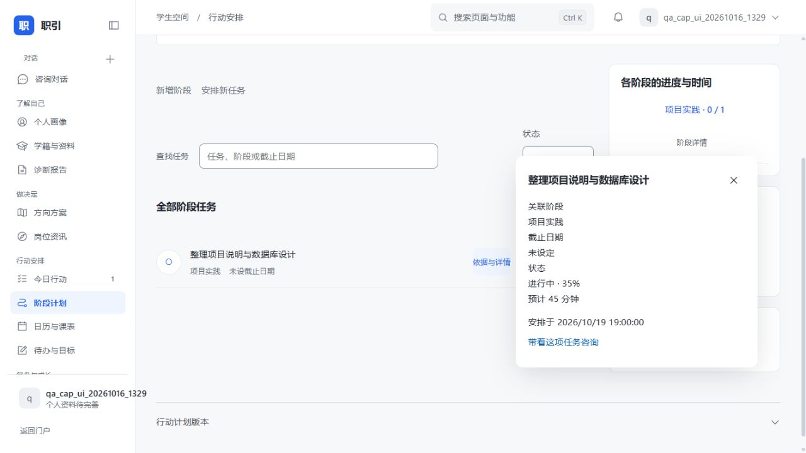
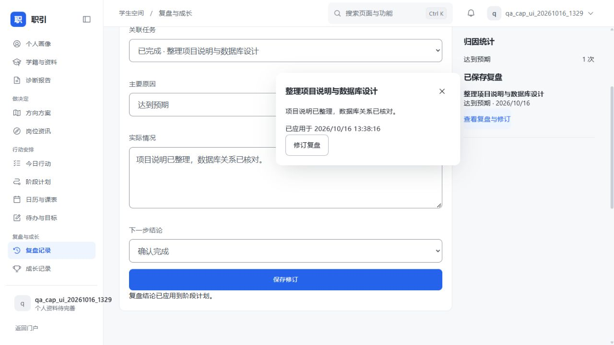

# 功能恢复与后端能力补齐清单

更新日期：2026-10-16。

## 实施依据

以用户确认的接入前版本 `640b01e` 为功能与交互参照。正式前端位于 `zhiyin-src/template/zhiyin-web`，保留选定的门户、侧栏、红蓝切换、不同页面的结构和导航下方的历史会话。新增编辑与说明采用触发位置附近的小卡片，不重建整套页面模板。

本轮对应此前登记的 G01—G12。新增 23 项 HTTP 接口，连同原有接口共 113 项；学生端操作清单为 73 项。接口定义以代码生成的 [后端接口与模型.json](后端接口与模型.json) 为准，逐项接入状态见 [后端能力与接入清单](后端能力与接入清单.md)。

“接口已实现”“当前系统联调通过”和“外部真实资料齐备”分别记录。接口存在不代表用户已有可供展示的数据，测试通过不代表完成生产发布。

## G01—G12 实施结果

表内路径均省略 `/api/v1` 前缀。

| 编号 | 能力 | 后端实现及接口 | 前端连接 | 验收与边界 |
| --- | --- | --- | --- | --- |
| G01 | 阶段依赖、阻塞、交接与时间 | `POST /app/plan/action/phases`、`PUT /app/plan/action/phases/{phase_id}`；稳定 ID、前置阶段、起止时间、阻塞条件、交接要求；校验缺失依赖与依赖循环 | 阶段计划中的新增、编辑与交接、阶段详情；显示未完成的前置阶段 | 创建和修改通过，循环依赖被拒绝。依赖影响下一任务推荐；文字条件作为人工核对依据，不声称自动理解和核验任意文字条件 |
| G02 | 任务状态与进度 | `pending/in_progress/waiting/completed`、0—100% 进度、等待原因；同步既有 done/done_at | 今日行动、阶段计划、任务详情、状态筛选与进度图 | 进行中、等待、完成、恢复使用真实字段；等待原因必填；100% 必须为完成状态 |
| G03 | 创建、编辑、排期、用时与拆分 | `POST /app/plan/action/tasks`、`PUT /app/plan/action/tasks/{task_id}`；所属阶段、开始时间、截止时间、预计分钟数、父任务关联；原子修改计划 | 今日行动和阶段计划可直接安排任务；编辑和拆分在旁边卡片中完成；日历读取任务排期 | 保存、刷新回读、跨账号拒绝通过；拆分禁止成环；重复保存同一表单更新已创建对象；拆分不自动完成原任务 |
| G04 | 五项偏好、加权比较与方向象限 | `GET/PUT /app/plan/direction-weights`、`GET /app/plan/direction-comparison`；专业对口、岗位数量、起薪水平、稳定性、通勤地点五项加权 | 方向页的权重保存、重算、量化依据与机会/可达性象限 | 权重持久化与计算通过。缺少正权重维度时总分为空；坐标分别需要记录。归一化加权结果是偏好辅助，不是客观录用概率 |
| G05 | 报告量表、雷达与门槛 | `GET/POST /app/measurements`；按资产类型、版本和对象保存数值、量表范围、门槛、来源、方法及测量时间，保留修订历史 | 报告与方向可录入已有量表结果、查看依据、数值和门槛；至少三个已有维度才画雷达 | 保存和回读通过。学生提交统一标记“本人录入”，即使引用外部测评，也不冒充系统核验；不从文字猜分，不对缺失维度填零 |
| G06 | 历史全文与版本对照 | `GET /app/assets/{asset_type}/versions/{version}/content`；行动与方向新版本保存当时正文快照；报告沿用版本全文接口；量表绑定版本 | 历史版本就近阅读；同维度、来源、方法和范围的量化记录可跨版本比较 | 编辑后旧快照不变。部署前未保存的正文不能反向恢复；缺少快照明确返回 404，不以最新版替代。不足两个可比量表版本时不画趋势 |
| G07 | 三周用时、课外容量与冲突 | `GET/PUT /app/schedule/semester`、`GET /app/schedule/workload`；学期首周周一、教学周数、时区、真实节次钟点；按时间区间计算课程与任务 | 日历中的学期设置、三周用时、冲突详情与待补充资料，窗口与三周安排对照一致 | 两节导入课程计算为 90 分钟，任务重叠正确识别。修复 JSON 课表导入丢失显式起止节次的问题；缺少排期、时长或节次钟点的项单列，不猜算 |
| G08 | 提醒完整历史与处理状态 | `GET /app/notifications`、`PATCH /app/notifications/{message_id}`；未读、已读、稍后、已处理、恢复及稍后时间 | 提醒中心的分类、查找、分页、稍后卡片与处理按钮 | 状态切换与另一账号修改拒绝通过，重建后仍可读。已读不等于已处理；处理提醒不自动完成关联任务 |
| G09 | 账号偏好与实际执行 | `GET/PUT /app/preferences`；主动提醒、跨午夜安静时段、时区、学校资料与上传材料参与分析设置；主动干预和提醒弹出遵守偏好 | 设置页读取和保存；明确说明关闭资料来源后的影响 | 偏好、账号隔离、提醒限制及按来源继续分析通过。分别关闭、同时关闭、重新开启四种组合均完成真实模型生成；旧推导信息、历史摘要、工具读数及缓存按下文规则隔离。21 项专项验收通过 |
| G10 | 结构化复盘、归因、修订与应用 | `GET/POST /app/reviews`、`PUT /app/reviews/{review_id}`、`POST /app/reviews/{review_id}/apply`；任务、原因、正文、结论、修订历史及应用时间；并发应用互斥 | 保存、修订、归因统计、明确点击应用到计划；完成与复盘进入时间线 | 保存、历史、完成回写、重复应用不重复执行、账号隔离通过。旧 notes 复盘继续展示，但不伪装成新结构化记录 |
| G11 | 后端 PDF/Word 生成与下载 | 既有 `POST /app/assets/export` 接入真实生成；新增 `GET /app/assets/download/{export_id}`，按账号校验归属，文件保存至持久对象卷 | 设置页选择资产与格式后下载；浏览器打印和 JSON 导出保留 | PDF 文件头、Word 正文与中文内容通过；另一账号下载返回 404；容器重建后仍可下载。同步生成，不伪造异步进度或下载地址 |
| G12 | 历史会话扩展状态 | `GET /app/sessions/{task_id}/snapshot`；成功轮次保存完整 ConversationTurnView，包括引导、流程、理论和可视内容等；旧请求重试不覆盖较新快照 | 历史消息与快照一起读取，恢复选项、流程与理论内容；切换账号清空状态 | 当前配置的真实模型完成一轮回复，快照与返回内容一致，重建后仍一致；另一账号被拒绝。部署前没有快照的会话只恢复已存消息，并说明扩展状态缺失 |

## 数据规则与兼容

1. 新增账号状态位于 `biz_student_state`，包含偏好、学期、量表、复盘、历史快照、会话快照、导出索引及分析来源索引 analysis_lineage。PostgreSQL 更新使用事务和行锁；不同账号不共享记录。任务与阶段仍保存在原计划资产中。
2. 通知新增 `processing_status`、`snoozed_until`，与派发状态分开。数据库调整采用新增表/列，保留现有账号和资产。
3. 手动修改使相关读缓存和 AI 建议缓存失效；完成行为进入行为日志。完成状态不由排期、截止日期或文字推断。
4. 课外剩余时间 = 用户填写的每周课外可用分钟 − 已排期未完成任务分钟；课程分钟单列。冲突指时段交叠，“没有课程”不直接等于有空。
5. 导出和上传材料使用持久对象卷，已有材料在重建前备份并迁移。本轮只向新建 `qa_cap_*` 账号写入验收记录，没有修改四个学生账号的业务数据。
6. 缺少量化来源、真实课表时间或历史快照属于数据缺失，不是生成演示数值的理由。接口保留入口，并展示具体缺失项。

## 资料参与分析的执行边界

关闭学校资料或上传材料后，AI 仍可使用当前输入、本人填写内容、自建笔记及允许的来源。关闭两项也不暂停纯文字对话。开关不删除原始资料，正常页面查看、手动修改、导出、独立资料导入和核验仍可使用。

执行规则如下：

1. 学校资料关闭时，课表、成绩和学校档案画像字段不进入模型。上传材料关闭时，携带附件的分析请求在读取正文之前明确拒绝，提示移除附件或开启设置；不假装已经读取附件。
2. 没有完整来源记录的旧推导画像、旧对话摘要、旧会话轮次和旧资产从受限分析中排除。它们仍保存在原页面和历史记录中；不声称能从旧摘要中精确拆出所有允许的句子。
3. 新生成的画像、缺口、会话轮次、行为、日历节点及资产正文保存内容指纹与来源集合。来源集合按该次分析允许的资料范围保守记录，而非声称逐句引用已经追踪。只要集合包含一个已禁用来源，整条推导内容不进入模型。继承旧任务或阶段文字的混合计划不会被误标为来源清晰。
4. 最近对话只续接来源允许的轮次。新产生的受限会话在数据库重新读取后仍可续接；未知来源的累积摘要不会因追加一轮而获得新的授权。
5. 画像、行为、计划、图表及内置模块工具均经过相同的读取边界。公开检索仅使用筛选后的主题和画像；个性化旧缓存不复用。未来新增模块数据能力必须补齐来源过滤，才可在受限分析中使用。
6. 页面 AI 缓存按来源组合隔离，修改资料开关同时作废该账号缓存。请求上下文按异步任务隔离，在异常、流式返回和取消时恢复，不影响其他账号和普通页面读取。
7. 模型声明的“本人填写”或“学校记录”不能变成可信来源，也不能借此覆盖本人填写的画像；真正的导入和核验写入路径保留。

专项证据见 [资料来源过滤验收结果.json](资料来源过滤验收结果.json)。旧数据无法确认来源时被排除，可能减少可用于分析的历史信息；这是数据溯源缺失的明确边界，不以猜测补齐。

## 验证结果

- 后端完整回归：937 项通过；资料来源、取消/并发隔离、模块读取等专项 11 项通过；最后的来源标记与本人填写保护专项合计 22 项通过。
- 前端自动化测试：16 项通过；79 个 DTO 同步，73 项学生端操作通过契约检查。
- Docker 前后端镜像构建通过，已部署到当前本机 `http://127.0.0.1:5173`。
- 当前系统真实 HTTP：61 个场景通过，覆盖 23 个新增接口及相关原接口，包含写入、回读、越权拒绝、校验、下载与真实模型快照。见 [新增能力接口验收结果.json](新增能力接口验收结果.json)。
- 后端容器重建后：10 个回读场景通过，覆盖设置、计划、复盘、量表、学期、通知、PDF/Word 与快照。见 [新增能力重启回读结果.json](新增能力重启回读结果.json)。
- 首次新增能力的浏览器验收：空账号新建阶段、保存日期与交接要求、新建 35% 进度且预计 45 分钟的任务、重复保存不重复新增、刷新回读、复盘保存与应用后完成数同步；验收过程中无控制台错误。
- 本次资料开关页面文案已构建。浏览器验收工具的 URL 访问策略拒绝读取本机页面，因此本次页面实看未完成；不以接口或构建测试替代浏览器验收。
- 来源过滤真实验收：21 项通过，覆盖四种来源组合、实际模型 SSE 终帧、缓存、派生画像数据库回读、附件拒绝、对话与普通读取保留。
- 服务间协议专项：85 项隔离 HTTP 检查通过，覆盖 12 个机器接口及关联管理操作。验证凭证隔离、并发领取、租约过期接管、授权撤销、失败重试和终态保护；自动发布仅验证拒绝路径，尚不代表真实候选构建或部署通过。见 [服务间接口验收结果.json](服务间接口验收结果.json)。
- 验收脚本：[student-capabilities.py](../../../scripts/acceptance/frontend/student-capabilities.py)。来源专项脚本为 [analysis-sources.py](../../../scripts/acceptance/frontend/analysis-sources.py)。凭据保存在仓库外，不写入结果文件。

原有学信网真实验证码、学校授权及其他外部服务配置继续按总清单管理。本轮没有把缺少真实外部资料的项目改记为验收成功。
