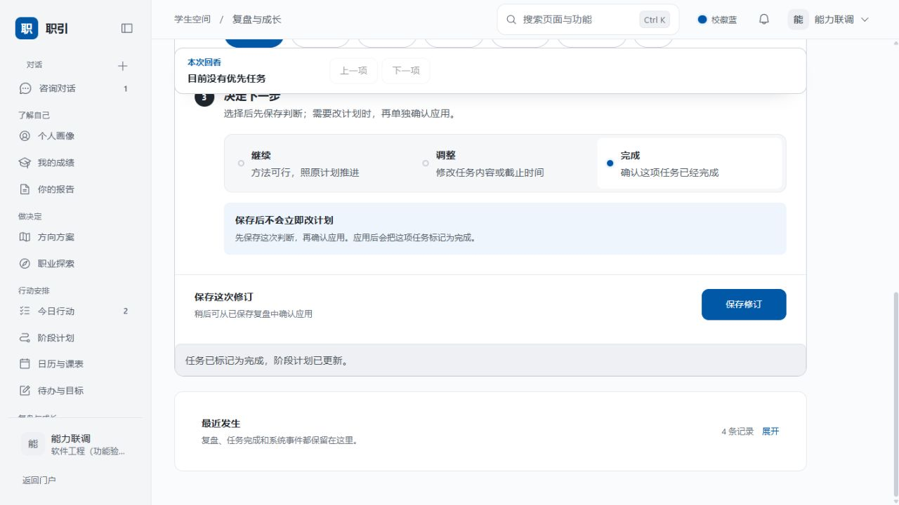

# 全功能与真实数据检查

后续状态：本文保留检查当时的发现；F01–F08 的修复与回归结果见[问题修复记录](全功能问题修复-2026-10-17.md)。

检查日期：2026-10-17（Asia/Shanghai）。源码：`codex/frontend-integration`，检查起点 `79fd587`。

## 结论与范围

正式学生端主要业务已经连接真实后端，能够持久保存；不是一套只在浏览器内改变显示的原型。但当前不能判定“所有功能都可用”：独立撤回成绩、独立撤回课表在运行环境返回 404；学生访问开发者入口会误退出登录；还存在资料刷新入口缺失和状态、日期表达问题。

用户明确当前账号用于测试，允许写入测试数据。本轮在当前账号检查页面与资料来源，并另建独立验收账号验证写入。测试数据不等于假接口：测试账号的合成资料可以保留，但不能把它作为真实个人经历的证明。

前端预览为 5287；为隔离浏览器登录状态，另在 5290 启动同一份源码。后端为当前本机 Docker 服务 8000。没有修改业务源码、接口或部署后端；只新增本检查记录与脱敏结果。未提交、未推送。

## 验证口径

- **浏览器通过**：实际点击、输入并观察成功结果；下表写明具体操作，不能外推到同一页全部按钮。
- **接口通过**：当前后端真实 HTTP 请求与业务断言通过；不等于每个对应页面控件都点过。
- **代码接入**：存在调用与结果处理，但本轮未完成该项正向操作。
- **不可用**：已复现失败或正常入口缺失。
- **条件不足**：缺少真实核验材料、有效工作流、管理权限或部署执行环境，不能宣称通过。

42 项前端测试通过；79 个模型同步、76 个学生操作与仓库 OpenAPI 对齐；类型检查与生产构建通过。运行后端 OpenAPI 逐项比对发现其中 2 个操作缺失。构建有 store 同时静态／动态导入的分包提示，不影响本次构建成功。

两组接口验收共 122 项断言：118 通过、4 失败。4 个失败来自两个撤回接口及其对应的数据回读断言，不代表 4 个独立接口故障；122 也不是独立功能数量。基础能力组含真实模型调用、存储回读、越权拒绝、PDF 文件头与 Word 文档内容检查。

## 完整功能清单与状态

### 门户、账号、导航与公共交互

|功能|本轮结果|
|---|---|
|经典动态门户、平台介绍、进入咨询|页面及入口可打开；固定产品介绍属于说明文案，不是个人业务数据|
|账号密码登录、恢复登录、退出|浏览器登录通过；HTTP 登录、退出、令牌撤销通过|
|账号注册|代码连接真实接口；本轮自动化账号由后端身份服务创建，未以此冒充注册按钮正向验收|
|未登录拦截、返回目标页面|代码接入；实际观察到未登录访问内页进入登录浮层|
|侧栏分类、移动导航、页面跳转|核心页面可到达；导航与旧地址重定向自动测试通过|
|搜索命令、筛选、键盘进入页面|浏览器输入“账号设置”并按 Enter 跳转通过|
|历史会话位于导航区域、手机历史面板|历史入口及真实记录显示通过；本轮仅有一个独立验收会话，未完成两个会话间往返切换|
|红蓝主色切换|浏览器切换红色、切回蓝色通过|
|浅色／深色／跟随系统、恢复外观|代码接入本地偏好；本轮未逐项切换全部主题|
|小浮层、关闭、移动适配|待办记录浮层、手机成绩说明浮层实际打开与关闭通过|
|404、路由加载失败、重试|实现与路由测试核对；本轮未主动破坏资源或断网验证所有错误分支|
|权限不足处理|失败：学生访问开发者入口导致本地登录状态清除，详见问题 F03|

### 咨询对话

|功能|本轮结果|
|---|---|
|选择主题、进入咨询会话|HTTP 进入真实任务会话通过；主题选择界面有真实入口|
|读取历史正文、会话快照与指导信息|HTTP 回读与快照一致性通过；浏览器显示实际保存的消息|
|发送消息、真实模型回复|HTTP 与手机浏览器发送均通过|
|流式文本与等待衔接|接口收到 49 个 SSE 帧，其中 46 个文本增量，约 8.35 秒结束并收到终态；手机浏览器等待时仅见一个“当前回复”区域，最终落为单条回复|
|停止接收、超时／失败保留输入|停止按钮可见；取消传输和终态要求有自动测试，本轮未在浏览器主动中断一轮生成|
|快捷选项、后续引导、处理记录卡|浏览器显示后端返回选项与处理记录入口；未逐一提交全部选项|
|解释依据、来源卡、理论卡|代码连接来源快照与理论接口；已有历史来源可见，无来源时不补造；本轮未逐张打开所有类型|
|上传材料|真实 multipart 文本材料上传返回成功；所有文件格式、超限、空文件未逐项实测|
|移除待发送附件、草稿恢复|代码接入；本轮未逐状态操作|
|复制回复、复制会话|入口存在；本轮未读取剪贴板逐字比较|
|展开／收起个人画像、调整分栏|代码接入真实 workspace；本轮未完成拖动、收起和跨尺寸组合验收|
|跨页携带问题进入咨询|代码使用 question／gap 等参数；已检查链接，未逐条发送上下文|

### 个人画像与学籍

|功能|本轮结果|
|---|---|
|读取画像、优先信息、字段来源、可信度、缺口与依赖|浏览器与真实 workspace 读取通过；服务模式没有用静态资料数组填空|
|更正字段、标识相关资产待核对|HTTP 更正专业并重新读取对应字段通过；未以此替代浏览器所有字段编辑验收|
|整体画像分析|当前真实模型 SSE 成功|
|维度解读、缺口追问|代码接入真实接口；本轮没有针对所有维度和缺口完成正向请求|
|量表数值、范围、阈值、来源、时间与历史|HTTP 保存、回读、历史记录及越权拒绝通过；对应页面表单未逐字段操作|
|导出个人画像 JSON|代码读取当前账号数据生成文件；本轮未下载并逐字比对|
|学籍汇总与核验入口|页面存在，来源读取实际资料；未把普通导入当作学信核验|
|学信网验证码核验|条件不足：没有本人有效验证码，本轮不能证明真实核验正向成功|
|资料来源管理与材料使用偏好|代码接入；浏览器保存偏好通过|

### 我的成绩

|功能|本轮结果|
|---|---|
|读取成绩、刷新、学年学期／性质筛选|真实数据能显示，筛选基于返回记录；本轮未穷举所有筛选组合|
|趋势／课程对比、成绩／绩点、分布与学分加权|图表来自实际记录计算；手机导入 91 分、2 学分、4.1 绩点后统计相应更新|
|粘贴表格／JSON、预览、确认替换成绩|手机浏览器实际预览并保存通过；HTTP 导入通过|
|文件导入|当前界面支持 JSON、CSV、TSV、TXT，最大 2MB；实现为本地解析后真实保存，本轮未逐格式上传|
|AI 学习分析|接入真实画像分析接口 portrait/analysis，并非独立学习诊断接口；模型接口通过，学习建议质量未单独验收|
|撤回成绩、保留课表|不可用：运行后端缺少 DELETE /app/academic/grades|
|查看学籍／个人画像、转到课表|导航入口与路由存在|

### 诊断报告

|功能|本轮结果|
|---|---|
|读取最新报告、版本、生成时间、待核对状态|原测试账号浏览器展示报告 V15；HTTP 读取通过|
|AI 执行摘要、判断说明、建议与来源元数据|真实 report/summary SSE 通过；正文另含固定章节引导文案，应与个性化分析区分|
|报告目录、判断依据小卡片、资料附录|实现已检查，页面可呈现；未点击全部目录与每条依据|
|历史版本列表及指定版本快照|HTTP 列表与快照通过，修改后旧快照不变的断言通过；本轮未浏览每一历史版本|
|打印|代码调用浏览器打印；本轮未完成系统打印对话框与打印文件验收|
|PDF／Word 导出及鉴权下载|公共资产导出能力实测成功，校验 PDF 文件头与 Word 内容；本轮使用行动计划资产，不宣称所有资产×格式组合均已测|
|携带变化继续咨询、核对画像|链接存在，未实际发送每个跳转问题|

### 方向方案与职业探索

|功能|本轮结果|
|---|---|
|主攻／平行／保留方向、目标、门槛、依据与风险|页面读取真实方向资产；缺失分数保留为空|
|方向切换与设为当前方向|HTTP 选择通过；本轮未浏览器切换全部选项|
|横向比较、权重调整、量化排名、机会与可达性|真实比较接口、权重保存、量表补充、缺失分值保持 null 的断言通过|
|方向历史、打印方案、关联计划与报告状态|历史接口通过；打印未实测，跨页路由已检查|
|职业／专业／校友资料列表、详情、原始来源|原测试账号页面有实际服务返回内容；新验收账号为空时显示空态，没有自动补假资料|
|职业搜索|目前只筛选已加载资料，不是发起全网招聘搜索|
|画像与职业匹配|真实 match/careers SSE 成功；新账号空态允许主动发起匹配|
|主动更新外部资讯|入口缺失：refreshIntel 封装和后端能力存在，但正式页面未调用；空态也没有主动拉取资料按钮|

### 今日行动与阶段计划

|功能|本轮结果|
|---|---|
|当前任务、逾期、后续候选、日期、完成计数|页面实际显示；后端行动计划和前端日期／筛选自动测试通过|
|完成／恢复任务|真实写入能力通过；通过工具模块恢复任务后侧栏计数同步变化|
|今日简报|当前真实模型接口成功，包括关闭上传材料分析后的运行|
|编辑任务、截止时间、排期、预计用时、状态、进度、等待原因|HTTP 新增与编辑通过；浏览器实际创建一项任务并在复盘页读到|
|拆分子任务、父子关联|HTTP 保存子任务与父任务关联断言通过；浏览器拆分表单未单独提交|
|阶段浏览、状态筛选、搜索|页面可显示，筛选纯函数测试通过；未穷举所有组合|
|新增／编辑阶段、日期、前置依赖、开始条件与交接要求|HTTP 新增、编辑通过；循环依赖返回 422 符合预期|
|阶段阻塞与推进状态|接口返回前置阻塞，浏览器显示相同状态|
|计划版本与历史内容|HTTP 列表、快照以及历史不被覆盖的断言通过|
|填写可用时间、跳转日历或咨询|页面入口存在；学期容量保存已在接口层验证|

### 日历与课表

|功能|本轮结果|
|---|---|
|周／月视图、日期切换、返回今天、当天课程与关键节点|页面和真实日历读取通过；未遍历所有日期|
|课表星期／节次展示、课程详情|实际显示返回课程；手机页面无整页横向溢出|
|导入／更新课表、预览与保存|与成绩共用真实导入组件；HTTP 课表导入并回读通过|
|撤回课表、保留成绩|不可用：运行后端缺少 DELETE /app/academic/courses|
|学期首周、周数、节次时间、每周可用时间|真实读取与保存通过|
|容量、课程占用、任务占用、冲突|HTTP 验证已配置容量、90 分钟课程与重叠冲突通过|
|当天建议、本周时间建议|两个真实模型 SSE 接口通过；不是在前端生成固定建议|

### 待办目标、复盘与完成记录

|功能|本轮结果|
|---|---|
|待办／目标新增、读取、完成、恢复、删除|HTTP 两种记录的完整闭环通过；浏览器新增待办、完成、刷新仍保留通过|
|查找、分页、类型切换、重复与长度校验|代码接入与页面控件检查；未穷举所有校验边界|
|记录信息小浮层|浏览器打开通过；发现日期口径不一致，见 F06|
|AI 待办建议、采纳写入、拒绝当前建议|生成接口通过；采纳使用真实新增待办接口，拒绝只隐藏本轮建议；本轮未逐一操作建议|
|复盘队列、选择任务、事实／原因／下一步|浏览器表单可操作；任务状态标签有误，见 F05|
|保存复盘、修订、历史、待确认调整|HTTP 保存与修订历史通过；浏览器保存真实复盘成功|
|将调整／完成应用到计划|HTTP 应用、重复应用幂等验证通过；浏览器点击应用后任务变为完成、导航计数更新|
|最近事件、任务完成记录、筛选|真实事件读取通过，浏览器显示新增记录数量|
|完成记录、形成条件、解锁时间、下一步|来自真实 achievements 接口；测试账号的解锁可能由测试操作或夹具产生，不是对真实人生经历的认证|

### 提醒、工具与系统

|功能|本轮结果|
|---|---|
|提醒列表、待处理／历史、关联操作|真实读取通过；原账号显示 7 条待处理|
|已读、已处理、稍后、恢复待处理|HTTP 状态变更、回读与越权拒绝通过；本轮未在浏览器逐按钮操作|
|稍后处理时间校验|前端自动测试覆盖过去时间拒绝；后端延后状态测试通过|
|主动提醒、安静时段、资料参与分析偏好|HTTP 保存回读及隔离断言通过；浏览器保存偏好成功|
|个人资料 JSON 导出|代码从当前服务读取后导出；浏览器文件下载未逐字验收|
|六个内置工具入口、说明与依赖图|存在并指向正式页面；这些是功能导航，不代表六个独立部署服务|
|服务端工具目录、按来源／可用性分组|实际读到两个启用模块 action_progress、achievements；没有把固定目录当作服务端发布结果|
|工具读取、调用、任务操作|浏览器读取行动计划进度、运行工具、恢复任务成功，计数随服务结果更新|
|已发布工作流运行、参数与写入确认|代码接入；本轮无指定已发布流程编号，正向执行未验证|
|使用指南、FAQ|静态说明与导航，非个人数据；页面可打开|

### 开发者管理（与学生权限分离）

代码保留以下功能：环境与身份、模块列表及策略、接入检查、模拟／真实预览、项目创建和维护、模板下载、源码版本上传、构建与验收记录、失败重试、版本包下载、发布申请和审批、发布历史、工作流创建／保存／发布／撤销发布／运行历史、动态配置重新加载。

本轮仅验证普通学生被拒绝访问，并发现误退出登录问题。没有提升账号权限，没有将管理功能的历史验收记录当成本轮通过。真实发布仍需要管理员、有效候选、Worker 和 Executor；“申请入队”不等于已部署。开发者预览中显式标注的 fixture 模式是调试工具，不属于学生正式页面的假数据兜底。

## 已确认问题

|编号|优先级|问题与依据|建议处理|
|---|---|---|---|
|F01|高|DELETE /api/v1/app/academic/grades 返回 404，运行 OpenAPI 无此操作；前端有撤回成绩按钮|同步后端实现并验证只删除成绩、保留课程；不能仅隐藏报错|
|F02|高|DELETE /api/v1/app/academic/courses 返回 404，运行 OpenAPI 无此操作；前端有撤回课表按钮|同步后端实现并验证只删除课程、保留成绩|
|F03|高|普通学生访问 /developer，后端把 AccessDenied 映射为 401/1004，前端触发 auth.expire；相同 token 随后调用 bootstrap 仍 200，证明并非真的失效|区分无权限与未登录；前端显示无权限，保留正常会话|
|F04|中|IntelView 只有 GET intel 与本地筛选，没有调用 refreshIntel；空态只能开始画像匹配|提供真实主动更新入口及无结果／失败反馈|
|F05|中|StructuredReview.vue:191 使用“完成／逾期／其余都进行中”；实际 pending 的新建任务被显示为进行中，等待中同样会误标|按后端 status 展示，不以未完成代替进行中|
|F06|中|待办列表使用 toLocaleDateString，SourceChip 直接截取原始时间日期；同一条记录列表为 10月17日，浮层为 10月16日|统一产品时区日期转换，保留原始时间用于追溯|
|F07|中|画像在首次读取的 0/0 状态也显示“关键信息已基本齐全”；源码只判断 gap 是否为零|区分未加载、无数据、缺口为空与资料完整|
|F08|中|工具“现在可以动手”使用全部未完成任务数；实际包含阶段阻塞和未来安排，示例中“提交成果”仍受前置阶段阻塞|计数与今日行动使用相同资格判断，或改为准确的“未完成任务”|

以上仅列证据足够明确的项目。没有把旧注释中出现 demo、mock、sample 自动判为当前使用假数据。

## 数据真实性

1. 正式数据容器的默认状态为空；dataMode 强制 service，网络／业务失败抛出错误；静态 student 数据数组已清空。保留的 demo、backendDemo 命名和历史方法并不证明调用路径还在造数据。
2. `scripts/fixtures/seed-students.py` 明确说明：对话由当前后端生成，报告、方向、计划、时间线是可重复的测试夹具；`student-personas.json` 包含林知远及当前页面同名任务。用户已确认这就是测试账号，因此属于可接受的验收数据，但不能称为真实个人资料。
3. 实际模型调用、SSE、资料保存、计划修改、复盘应用、提醒和导出经过本轮 HTTP 验证。空职业资料页没有自动补预置职业。
4. 固定门户介绍、说明文字、报告章节引导和内置导航配置是产品内容。它们不应被描述为 AI 实时生成的个性化结果。
5. 学籍核验、管理发布、未指定的已发布工作流，以及表中明确标记未实测的浏览器操作仍需补验；不能据此签署“全功能全部通过”。

## 浏览器与证据

桌面检查了核心业务页及设置、提醒、工具、指南；手机以 390×844 视口检查了 15 个页面入口及文档宽度，另实际操作手机对话与成绩导入／浮层。15 个页面在所测状态未发现整页水平溢出。滚动条占位时内容视口为 380px，正常无滚动条时为 390px。不是实体手机软键盘验收，也不是所有弹层、所有数据量的穷举。

证据目录：[功能验收-2026-10-17](功能验收-2026-10-17/)。包括接口能力验收、补充接口验收、手机页面宽度检查，以及复盘应用、手机成绩浮层和真实回复截图。没有包含密码、访问令牌或导出文件内容。

## 后续验收顺序

先修复两个接口缺失及权限误退出，再处理职业资料刷新和状态日期口径。之后补齐注册按钮、历史会话往返、停止流式、复杂导入格式、所有导出组合和管理端正向流程。条件不足的学信核验与真实发布单独记录，不用样例结果代替。
