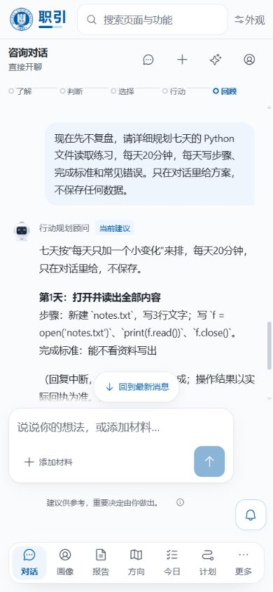

# 对话角色与状态条修复验收（2026-10-22）

## 修复结论

原问题不只是显示：主理依赖模型可选调用 use_specialist，专业请求可能不加载相应职责；协作加载又会直接覆盖主理。停止生成时，前端清空临时角色后使用旧身份，后端也把未完成回复保存为旧主理，刷新后会错误署名。

本次保留 AI 语义判断，无关键词路由、无额外独立角色分类模型。当前启用的五份真实角色职责进入上下文，同一次模型回复明确给出经过服务端校验的主理、工作重点、协作者与正文。界面只流式显示正文，不显示内部 JSON。

| 角色 | 工作重点 | 行为 |
| --- | --- | --- |
| profile_analyst | collect 了解自己 | 梳理本人经历、偏好、约束 |
| 职业分析顾问 career_advisor | diagnose 梳理判断 / decide 比较选择 | 分析方向、差距与取舍 |
| 行动规划顾问 path_planner | act 安排下一步 | 拆步骤、时间与完成标准 |
| 行动支持顾问 companion_coach | review 回顾调整 | 复盘执行反馈与卡点 |
| 信息侦查员 info_scout | 协作者 | 查证事实，不替代最终主理 |

角色中文名最终由现有注册表提供；普通闲聊与事实答复可保留当前重点。顶部是可随话题调整的当前工作重点，不表示已经按顺序完成所有阶段。

## 实施细节与边界

- 方法卡加载与主理选择分离；use_specialist 不再抢占主理。角色禁用、职责与重点不匹配、侦查员作为主理均被拒绝。
- 只有生成有效时提交会话主理与阶段。失败、停止后顶部回到已确认阶段；半段回复独立保留实际作者，后端历史与重放一致。历史旧数据没有批量重写。
- 会话切换时不采用其他会话快照；非生成中不使用遗留临时阶段。
- 模型输入历史使用内部传输格式，存储与展示仍为自然正文；旧消息缺少可信身份时不编造身份。
- 无效完整输出最多尝试一次只读格式整理，没有工具且工具调用额度为零，使用既有工具回执，避免重复业务写入。仍无效则保留未完成状态，不默默回落成默认顾问。取消后不触发整理。
- 探索 mode 仅接受 explore/answer/act/paused，与 focus 的 review 明确区分。
- 源码默认主提示词及当前数据库 conversation.main 仅修改两段：正文与封装边界、已预加载角色的调用说明。保留其余业务规则及管理员配置；没有全量同步注册表。修改前内容备份在本机 output/before-role-prompt-20261022.json，不纳入 Git。
- DeepSeek JSON 模式仍可能需要格式整理。官方要求 JSON 指令与示例，并提示偶发空输出：[官方说明](https://api-docs.deepseek.com/zh-cn/guides/json_mode/)。不能把约束理解为提供商绝对保证；服务端校验和一次无工具整理负责收口。

## 验收记录

- 真实模型独立场景：了解、判断、选择、规划、复盘、普通事实、侦查协作，角色与保存阶段一致。
- 真实同一会话连续五轮：规划 → 复盘 → 规划 → 了解自己 → 比较选择，5/5 有效，保存身份和阶段正确；最终测试两轮使用一次无工具整理，未额外执行业务操作。
- 真实侦查协作：结构化结果包含 profile_analyst 与 info_scout，主理保持 profile_analyst。
- 无文字图形视觉输入仍能正确识别相对位置，38 次正文增量，没有角色元数据泄漏。
- 自动回归与最终浏览器验收结果见下方补充。

测试输入均为虚构数据；真实模型专项使用隔离内存资产与当前数据库只读配置，浏览器使用专用测试账号。未改写既有学生资料。

证据目录：[角色与状态条修复-2026-10-22](角色与状态条修复-2026-10-22/)。整改前检查：[对话角色与状态条检查-2026-10-22](对话角色与状态条检查-2026-10-22.md)。

## 最终回归与本机部署

- 后端全量：1254 passed（89.66 秒），仅一条现有 Starlette TestClient 弃用警告。
- 前端：108 passed；生产构建（含 vue-tsc 类型检查）通过；后端契约检查 98 schemas / 91 operations 通过。
- 最终浏览器：真实测试账号在已有会话中从已确认 review 发起规划；生成中显示 path_planner / act，采到 9 个不同正文长度，主动停止后回到 review。刷新后半段回复仍为 path_planner，顶部仍为 review，无内部 JSON 泄漏。
- 发现并修复停止恢复提示的小问题：刷新时恢复 stopped 状态，无障碍播报不再把主动停止报成“回复失败”。修改后重新运行前端测试及构建通过，浏览器刷新确认“回复已停止，已接收的内容保留”。
- 停止后继续咨询正常：15 个不同正文长度，最终提交 path_planner / act。测试账号已退出，临时标签页已关闭，浏览器视口已恢复。
- 本机后端及前端容器均按当前源码重建并启动；后端健康检查 HTTP 200。后端最终镜像 sha256:37095a5ca920b762bdcfd77ed0b49d9f81a53d2ab33c26aa44fa9878f63f1320。没有清空数据库或批量覆盖配置。

前期测试账号中的旧半段回复仍保留原错误身份，作为修复前记录；本次未将修复前消息冒充修复后结果。自动回归保证明确的权限和状态边界；模型语义选择不保证对任意输入永远无误，持续验收仍应覆盖真实业务对话。
